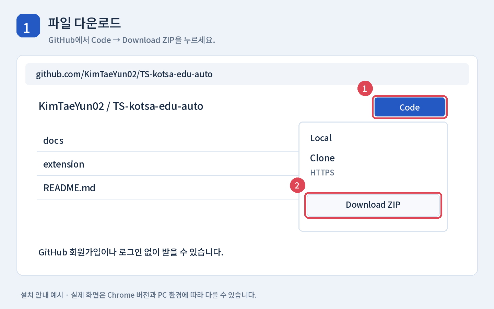
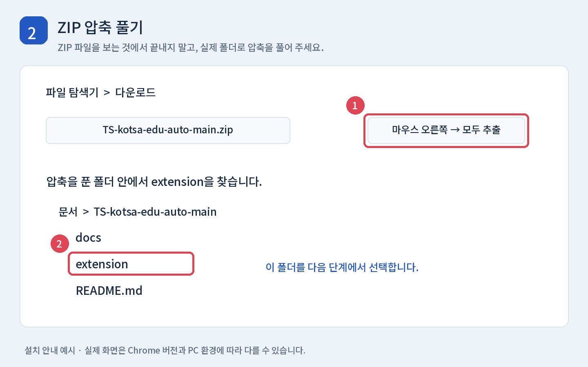
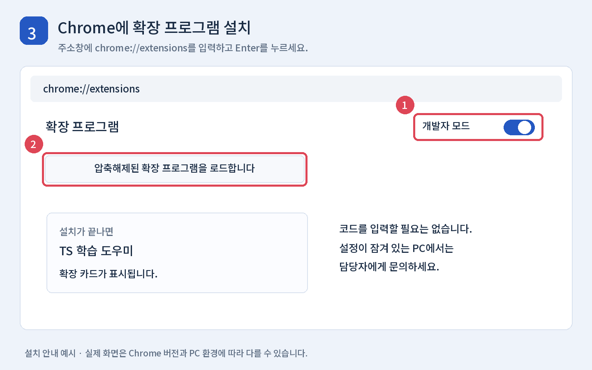
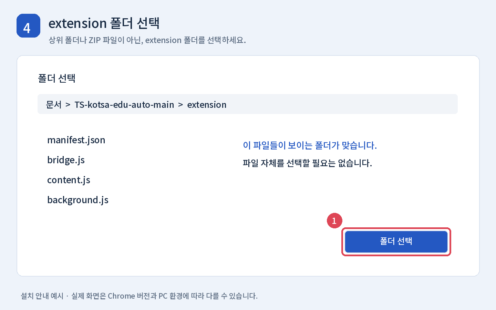
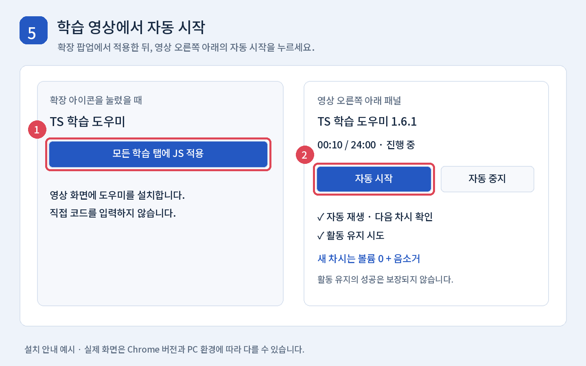

# TS 학습 도우미

**컴퓨터에 익숙하지 않아도 아래 순서대로 따라 하면 설치할 수 있습니다.** 한국교통안전공단 교육 영상을 일반 속도로 재생하고, 사이트에서 학습 완료가 확인되면 다음 차시로 이동하는 Chrome 확장 프로그램입니다.

현재 버전: **1.6.1** · Windows PC와 Chrome 기준 안내

ZIP으로 전달받았다면 압축을 푼 폴더의 **INSTALL.html**을 더블클릭해 같은 안내를 그림과 함께 읽을 수 있습니다.

## 어떤 기능인가요?

| 기능 | 설명 |
| --- | --- |
| 자동 넘기기 | 영상이 끝나고 사이트가 완료로 표시하면 다음 차시로 이동합니다. 30초마다 확인하므로 잠시 기다릴 수 있습니다. |
| 새 차시 음소거 | 새 영상이 열리면 볼륨을 0으로 설정하고 음소거합니다. |
| 활동 유지 시도 | 30초마다 마우스 이동 이벤트를 보내는 기능입니다. 사이트가 이를 무시할 수 있어 세션 연장이 보장되지는 않습니다. |
| 자동 중지 | 재생과 자동 동작을 멈춥니다. |

배속 변경과 별도 End 요청 기능은 없습니다. 평가는 직접 응시하고 설문도 직접 작성해야 합니다. 마지막 차시에는 학습 목록에서 필요한 절차를 확인하세요.

## 준비할 것

- **Windows PC와 Google Chrome**을 준비합니다. 휴대폰 Chrome용 설치 방법이 아닙니다.
- 교육 사이트에 로그인할 수 있어야 합니다. GitHub 회원가입과 프로그램 개발 도구 설치는 필요 없습니다.
- 설치한 폴더를 계속 사용할 수 있는 곳에 보관합니다. 설치 후 폴더를 지우거나 이동하면 확장 프로그램이 실행되지 않을 수 있습니다.
- 부대 PC에서 확장 설치나 개발자 모드가 관리 정책으로 제한되면 담당자에게 문의하세요. 제한을 해제하는 방법은 이 안내에 포함하지 않습니다.

> 아래 그림은 이해를 돕기 위해 제작한 **예시 화면**입니다. 실제 브라우저 버전과 화면 크기에 따라 버튼 위치와 이름이 조금 다를 수 있습니다.

## 1단계 파일 다운로드

1. [GitHub 저장소](https://github.com/KimTaeYun02/TS-kotsa-edu-auto)를 엽니다.
2. 파일 목록 위쪽의 초록색 **Code** 버튼을 누릅니다.
3. 메뉴 아래의 **Download ZIP**을 누릅니다.
4. 다운로드가 끝날 때까지 기다립니다. 보통 파일 이름은 `TS-kotsa-edu-auto-main.zip`입니다.



## 2단계 압축 풀기

1. 키보드에서 **Windows 키와 E 키**를 같이 누르면 파일 탐색기가 열립니다.
2. 왼쪽에서 **다운로드** 폴더를 엽니다.
3. 받은 ZIP 파일을 마우스 오른쪽 버튼으로 누릅니다.
4. **모두 추출** 또는 **압축 풀기**를 누릅니다. 압축 프로그램에 따라 이름이 다를 수 있습니다.
5. 예를 들어 `문서` 안에 압축을 풀고, 압축 해제가 끝나면 열린 폴더로 들어갑니다.
6. 안쪽에 **extension**이라는 폴더가 보이는지 확인합니다.

**ZIP 파일을 두 번 눌러 안을 보기만 한 것은 압축 해제가 아닙니다.** 반드시 압축을 푼 실제 폴더를 사용하세요.



## 3단계 Chrome의 확장 프로그램 화면 열기

1. Chrome을 엽니다.
2. 화면 맨 위 **주소창**을 누릅니다. 검색 사이트의 검색창이 아닙니다.
3. 아래 주소를 입력하고 **Enter**를 누릅니다.

```text
chrome://extensions
```

4. 오른쪽 위 **개발자 모드** 스위치를 켭니다.
5. 왼쪽 위에 나타나는 **압축해제된 확장 프로그램을 로드합니다**를 누릅니다. Chrome 버전에 따라 **압축해제된 확장 프로그램 로드**로 표시될 수 있습니다.

개발자 모드는 이 확장 프로그램을 내 PC의 폴더에서 읽어 오기 위한 설정입니다. 코드를 입력하거나 수정할 필요는 없습니다.



## 4단계 extension 폴더 선택

1. 폴더 선택 창에서 **2단계에서 압축을 푼 위치**로 이동합니다.
2. `TS-kotsa-edu-auto-main` 폴더 안으로 들어갑니다. 받은 압축 파일 종류에 따라 뒤에 `-main`이 없을 수도 있습니다.
3. **extension** 폴더를 선택합니다.
4. 창 아래의 **폴더 선택**을 누릅니다.
5. Chrome 확장 프로그램 화면에 **TS 학습 도우미**가 표시되면 설치가 완료된 것입니다. 카드의 스위치는 켜진 상태로 둡니다.

**선택할 것은 extension 폴더입니다.** ZIP 파일, 저장소 전체 폴더, `manifest.json` 파일 자체를 선택하는 것이 아닙니다. `extension` 폴더 바로 안에 `manifest.json`, `bridge.js`, `content.js` 등이 있으면 올바른 위치입니다.



## 5단계 확장 프로그램을 툴바에 고정

1. Chrome 오른쪽 위 주소창 옆의 **퍼즐 모양 확장 프로그램 버튼**을 누릅니다.
2. 목록에서 **TS 학습 도우미**를 찾습니다.
3. 옆에 있는 **핀 모양**을 누릅니다.
4. 이제 주소창 옆에서 도우미 아이콘을 바로 누를 수 있습니다. 아이콘 모양은 브라우저에서 정한 기본 그림일 수 있습니다.

고정하지 않아도 실행할 수 있지만, 매번 퍼즐 메뉴에서 찾아야 합니다.

## 6단계 교육 사이트에서 실행

1. [한국교통안전공단 교육 페이지](https://edu.kotsa.or.kr/user/learn/LearnUserMain.do)에 로그인합니다.
2. 수강할 교육의 **영상 페이지**를 엽니다. 교육 목록 화면만 열어 둔 상태에서는 영상 패널이 나타나지 않습니다.
3. 설치 전부터 영상 페이지를 열어 두었다면 **F5**를 눌러 새로고침합니다. 영상이 열리기 전 목록으로 돌아갔다면 다시 영상을 엽니다.
4. 주소창 옆 **TS 학습 도우미** 아이콘을 누릅니다.
5. 팝업에서 **모든 학습 탭에 JS 적용**을 누릅니다. 여기서 JS 적용은 영상 화면에 도우미 버튼을 표시한다는 뜻이며, 코드를 입력할 필요는 없습니다.
6. 영상 오른쪽 아래에 **TS 학습 도우미** 패널이 나타나면 **자동 시작**을 누릅니다.
7. 영상이 재생되지 않으면 영상 가운데의 원래 재생 버튼을 한 번 직접 누릅니다.



## 실행 후에는 어떻게 되나요?

- 영상은 **일반 속도인 1배속**으로 재생합니다.
- 새 차시의 소리는 자동으로 **0과 음소거**로 설정합니다. 소리를 들으려면 영상의 스피커 버튼에서 음소거를 풀고 볼륨을 올리세요. 다음 차시에는 다시 음소거됩니다.
- 영상이 끝나고 사이트의 완료가 확인되면 **최대 약 30초 후** 다음 차시로 넘어갑니다. 비활성 탭이나 절전 상태에서는 더 늦어질 수 있습니다.
- **자동 중지**를 누르면 재생, 자동 이동, 활동 유지 시도를 멈춥니다. 다시 시작하려면 **자동 시작**을 누릅니다.
- **활동 유지 시도**는 기본적으로 켜져 있습니다. 필요 없으면 체크를 해제하세요. 패널의 횟수와 시각은 이벤트를 보낸 기록이며 세션 연장 성공 표시가 아닙니다.
- PC 절전·화면 잠금·서버의 최대 세션 만료를 막는 기능은 아닙니다. 활동 유지 이벤트가 실제 마우스 입력으로 인정되지 않는 사이트에서는 로그인이 만료될 수 있습니다.

처음에는 한 차시가 끝날 때까지 직접 확인해 주세요. 진행률과 수료 여부는 교육 사이트의 표시를 기준으로 확인합니다.

## 안 될 때 확인할 것

| 증상 | 확인할 순서 |
| --- | --- |
| 개발자 모드나 설치 버튼이 안 보여요 | `chrome://extensions`를 주소창에 입력했는지 확인합니다. 관리되는 PC에서 설정이 제한되면 담당자에게 문의합니다. |
| 매니페스트가 없다는 오류가 나요 | 압축을 실제로 풀었는지, 그 안의 **extension 폴더**를 선택했는지 확인합니다. |
| 설치했는데 패널이 안 나와요 | 영상 페이지를 열고 F5 → 확장 아이콘 → **모든 학습 탭에 JS 적용** 순서로 실행합니다. |
| 팝업에 학습 탭이 0개라고 나와요 | 확장을 설치한 것과 **같은 Chrome 프로필·일반 창**에서 교육 사이트를 엽니다. 다른 브라우저나 시크릿 창에 열어 두지 않았는지 확인합니다. |
| 영상이 자동으로 시작하지 않아요 | 사이트의 원래 영상 재생 버튼을 직접 누릅니다. |
| 영상 소리가 안 나요 | 정상 동작입니다. 필요하면 영상의 음소거를 풀고 볼륨을 올립니다. |
| 영상이 끝났는데 안 넘어가요 | 30초 정도 기다리고 사이트가 **완료**로 표시하는지 확인합니다. 미완료·평가·설문·마지막 차시에서는 멈출 수 있습니다. |
| 활동 시도 횟수는 늘지만 로그인 시간이 안 늘어요 | 사이트가 코드로 만든 이벤트를 인정하지 않을 수 있습니다. 실제 마우스를 움직여 비교하고 필요하면 다시 로그인합니다. |
| 폴더를 옮기거나 지운 뒤 실행이 안 돼요 | 새 위치의 extension 폴더를 다시 로드합니다. 계속 사용할 폴더는 이동·삭제하지 마세요. |

다른 사람에게 오류 화면을 보낼 때는 **이름·수강 번호·쿠키·로그인 토큰을 가려 주세요.** 개발자 도구의 요청 Headers 전체를 보내지 않아도 됩니다.

## 새 버전으로 바꾸기

1. 위의 **1단계**처럼 최신 ZIP을 다시 받습니다.
2. 새 ZIP을 압축 해제합니다.
3. 기존에 설치한 `extension` 폴더 안의 파일을 새 `extension` 안의 파일로 교체합니다.
4. `chrome://extensions`에서 **TS 학습 도우미 카드의 새로고침 버튼**을 누릅니다.
5. **교육 사이트 영상 페이지도 F5**로 새로고침합니다.
6. 필요하면 확장 아이콘 → **모든 학습 탭에 JS 적용** → **자동 시작**을 누릅니다.

두 버전을 동시에 설치할 필요는 없습니다. 설치할 때 썼던 폴더 위치를 기억해 두면 업데이트가 쉽습니다.

## 삭제하기

1. `chrome://extensions`를 엽니다.
2. **TS 학습 도우미** 카드에서 **삭제**를 누릅니다.
3. 영상 페이지를 새로고침하면 페이지에 남아 있던 도우미 패널도 사라집니다.
4. 더 이상 필요 없으면 PC에 보관한 압축 해제 폴더를 지웁니다.

## 참고

- 이 프로젝트는 한국교통안전공단의 공식 확장 프로그램이 아닙니다.
- 자동 넘기기는 사용자 환경에서 동작했다는 피드백이 있으나 모든 강의·브라우저에서 보장되지는 않습니다. 사이트가 바뀌면 동작하지 않을 수 있습니다.
- 설치 절차 참고: [Chrome 공식 확장 프로그램 설치 안내](https://developer.chrome.com/docs/extensions/get-started/tutorial/hello-world#load-unpacked).
- 구현, 권한, 활동 유지의 제한과 개발자 테스트 설명은 [기술 문서](docs/TECHNICAL.md)를 참고하세요. README만 따라 설치하는 데 Node.js나 명령어 실행은 필요 없습니다.
